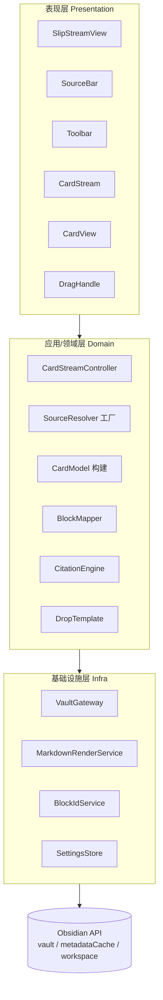
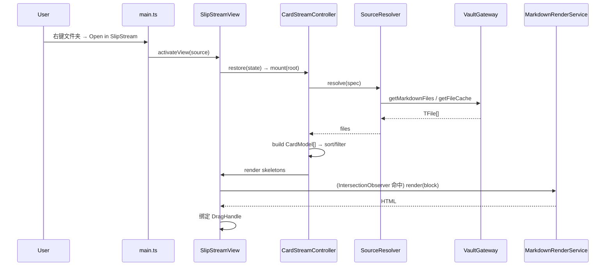
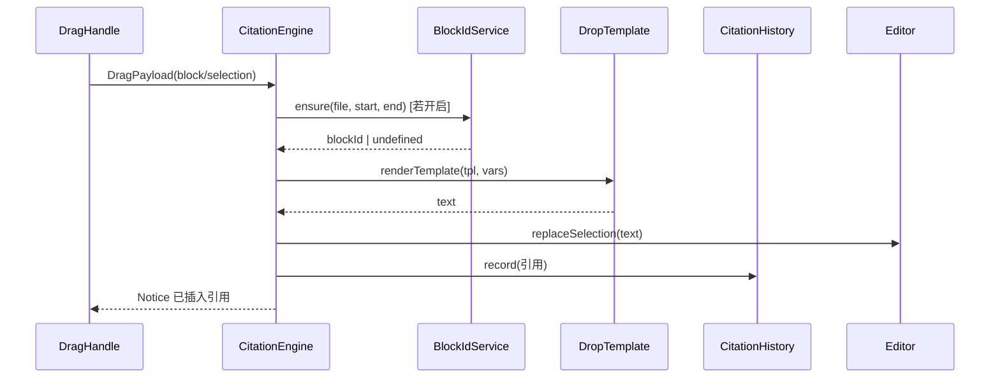

# SlipStream · 开发文档（Technical Design Doc）

| 项目 | 内容 |
| --- | --- |
| 产品名称 | **SlipStream** |
| 插件 ID | `slipstream` |
| 文档版本 | 0.1.0 |
| 对应 PRD | [PRODUCT-0.1.0.md](./PRODUCT-0.1.0.md) |
| 代码仓库 | https://github.com/saltcoffee/slip-stream |
| 技术栈 | TypeScript + Obsidian Plugin API + esbuild |
| 平台 | 桌面端（`isDesktopOnly: true`） |
| 最后更新 | 2026-11-12 |

---

## 1. 技术选型 (Tech Stack)

| 维度 | 选择 | 理由 |
| --- | --- | --- |
| 语言 | TypeScript 5.x（`strict: true`） | 类型安全，Obsidian 官方模板即 TS |
| 运行时 | Obsidian 桌面端（Electron + CodeMirror 6） | 目标平台 |
| 构建 | esbuild（官方 sample plugin 同款） | 快、零冗余、单文件产物 |
| UI | 原生 DOM + 轻量渲染函数（**不引入前端框架**） | v0.1.0 卡片流结构稳定；避免框架体积与生命周期复杂度。若后续复杂度上升（多源混合、复杂状态）再评估 Preact |
| Markdown 解析 | `metadataCache`（Frontmatter 边界与块类型）+ `markdown-it` 的 `token.map`（列表项等细粒度行范围）+ `MarkdownRenderer.render`（官方渲染） | 原生元数据保证 Frontmatter/块类型与 Obsidian 一致，markdown-it 补足列表项级行映射，官方渲染保证展示一致 |
| 测试 | Vitest + 自建 Obsidian API mock | 纯逻辑可测；UI 以手动清单验收 |
| 包管理 | npm | 与社区插件生态一致 |

> **不引入**：React/Vue/Svelte、CSS-in-JS、状态管理库、网络请求库、原生 Node 模块。

### 1.1 依赖清单

```jsonc
// dependencies（会被打包进 main.js）
{ "markdown-it": "^14.1.0" }

// devDependencies
{
  "obsidian": "latest",
  "typescript": "^5.4.0",
  "esbuild": "^0.20.0",
  "vitest": "^1.6.0",
  "jsdom": "^24.0.0",
  "@types/markdown-it": "^14.1.0",
  "builtin-modules": "^3.3.0",
  "tslib": "^2.6.0"
}
```

`obsidian` 为 external，不打包。

---

## 2. 目录结构 (Project Layout)

```
slipstream/
├── manifest.json                 # 插件清单
├── package.json
├── tsconfig.json
├── esbuild.config.mjs
├── versions.json                 # 版本 → minAppVersion 映射
├── styles.css                    # 全局样式（发布必带）
├── README.md
├── README.zh-CN.md
├── assets/                       # README 图片（打赏二维码）
├── LICENSE
├── src/
│   ├── main.ts                   # 插件入口：注册视图/命令/菜单/设置
│   ├── constants.ts              # VIEW_TYPE、事件名、MIME、默认值
│   ├── settings/
│   │   ├── settings.ts            # Settings 接口 + DEFAULT_SETTINGS
│   │   └── SettingsTab.ts         # PluginSettingTab 实现
│   ├── view/
│   │   ├── SlipStreamView.ts      # ItemView 壳 + 生命周期
│   │   ├── SourceBar.ts           # 顶部数据源切换器
│   │   ├── Toolbar.ts             # 密度/过滤/排序/更多菜单
│   │   ├── CardStream.ts          # 卡片流容器 + 虚拟滚动调度
│   │   ├── CardView.ts            # 单卡片 DOM（Header + Body）
│   │   ├── DragHandle.ts          # 段落级手柄与拖拽发起
│   │   └── states.ts              # 骨架/空/错误 组件
│   ├── domain/
│   │   ├── types.ts               # 领域类型与端口接口
│   │   ├── CardStreamController.ts # 数据源→卡片→过滤/排序/状态编排（应用层）
│   │   ├── sources/
│   │   │   ├── SourceResolver.ts  # 端口接口 + 工厂
│   │   │   ├── FolderSource.ts
│   │   │   ├── TagSource.ts
│   │   │   ├── LinkSource.ts      # backlinks / outlinks
│   │   │   └── BookmarkSource.ts  # 0.1.1 规划（内部 API，0.1.0 不实现）
│   │   ├── CardModel.ts           # 从 TFile+Cache 构建 ViewModel
│   │   ├── BlockMapper.ts         # 源码 → 块范围映射
│   │   ├── CitationEngine.ts      # 拖拽 payload → 落盘文本
│   │   ├── CitationHistory.ts     # 引用历史记录、查询与跳回原文
│   │   └── DropTemplate.ts        # 模板选择与变量替换
│   ├── infra/
│   │   ├── VaultGateway.ts        # 封装 vault / metadataCache 读取
│   │   ├── MarkdownRenderService.ts  # 封装 MarkdownRenderer + 缓存
│   │   └── BlockIdService.ts      # 原子写 Block ID
│   └── util/
│       ├── debounce.ts
│       ├── i18n.ts
│       ├── dom.ts                 # createEl / 事件辅助
│       └── logger.ts
└── tests/
    ├── block-mapper.test.ts
    ├── drop-template.test.ts
    ├── folder-source.test.ts
    └── fixtures/*.md
```

**文件行数红线**：单文件 ≤ 600 行；接近时按职责拆分（如 `CardView` 的 Header/Body 拆子函数或子模块）。

---

## 3. 架构分层与依赖方向 (Architecture)



**依赖规则（强约束）**

1. 表现层**只依赖**领域层接口，绝不直接 `app.vault.*` / `app.metadataCache.*`；所有读写经 `VaultGateway`。
2. 领域层不依赖 `obsidian` 的具体 UI 类，仅依赖抽象端口（便于测试时 mock）。
3. 基础设施层是唯一接触原生 Obsidian API 的位置。
4. 数据模型（`CardModel`）与渲染 DOM 解耦：VM 只含数据，`CardView` 负责渲染。
5. 单向数据流：`SourceSpec → CardModel[] → 过滤/排序 → CardStream 渲染`；交互回写经由 controller。

---

## 4. 核心模块详设

### 4.1 插件入口 `main.ts`

职责：注册视图、命令、右键菜单、设置页；持有全局服务单例。

```ts
export default class SlipStreamPlugin extends Plugin {
  settings!: Settings;
  gateway!: VaultGateway;
  renderService!: MarkdownRenderService;
  blockIds!: BlockIdService;
  cite!: CitationEngine;
  history!: CitationHistoryService;

  async onload() {
    await this.loadSettings();
    this.gateway = new VaultGateway(this.app);
    this.renderService = new MarkdownRenderService(this.app);
    this.blockIds = new BlockIdService(this.app);
    this.cite = new CitationEngine(this);
    this.history = new CitationHistoryService(this.app, this);

    this.registerView(VIEW_TYPE_SLIPSTREAM, (leaf) => new SlipStreamView(leaf, this));
    this.addSettingTab(new SlipStreamSettingsTab(this.app, this));
    this.addRibbonIcon('layers', 'Open SlipStream', () => this.activateView());

    this.registerCommands();
    this.registerMenus();
    this.registerMetadataRefresh();
  }

  async activateView(source?: SourceSpec) {
    const { workspace } = this.app;
    const existing = workspace.getLeavesOfType(VIEW_TYPE_SLIPSTREAM)[0];
    const leaf = existing ?? (this.settings.defaultPlacement === 'split'
      ? workspace.getLeaf('split', 'vertical')
      : workspace.getRightLeaf(true) ?? workspace.getLeaf('tab'));
    // 仅在“新建视图”或“显式带 source”时改写 state，避免仅聚焦时清空当前数据源
    if (!existing || source) {
      await leaf.setViewState({ type: VIEW_TYPE_SLIPSTREAM, active: true, state: { source } });
    }
    workspace.revealLeaf(leaf);
  }

  onunload() { this.app.workspace.detachLeavesOfType(VIEW_TYPE_SLIPSTREAM); }
}
```

**命令注册**（`registerCommands`）：使用 `checkCallback`，仅在需要活动文件时校验。

| 命令 id | 说明 |
| --- | --- |
| `slipstream-open` | 打开/聚焦视图 |
| `slipstream-open-folder` | 以当前文件所在文件夹为源 |
| `slipstream-open-backlinks` | 以入链为源 |
| `slipstream-open-outlinks` | 以出链为源 |
| `slipstream-history` | 打开引用历史面板 |

**右键菜单**（`registerMenus`）：

```ts
this.registerEvent(this.app.workspace.on('file-menu', (menu, file) => {
  if (file instanceof TFolder) {
    menu.addItem((i) => i.setTitle(t('menu.openFolder'))
      .setIcon('layers')
      .onClick(() => this.activateView({ kind: 'folder', value: file.path })));
  }
}));
```

> 标签面板的右键事件在公开 API 中不稳定，0.1.0 以 Source Bar 手动输入 + 命令为兜底；若内部事件可用则接入（`app.workspace.on('tag-menu')`，需运行时存在性检测）。
> 编辑器右键「在 SlipStream 中查看相关笔记」用 `workspace.on('editor-menu', (menu, editor, view) => …)`，以 `view.file?.path` 作为 `anchorFile` 打开入链视图。

**元数据刷新订阅**（`registerMetadataRefresh`）：监听 `vault.on('modify' | 'delete' | 'rename')` 与 `metadataCache.on('changed')`，以 **250ms 防抖**广播；后台刷新（silent）不显示骨架屏，避免闪烁；仅 md 文件触发，自写（Block ID）按路径抑制。

---

### 4.2 视图层 `SlipStreamView`

`ItemView` 生命周期与状态持久化：

```ts
export class SlipStreamView extends ItemView {
  constructor(leaf: WorkspaceLeaf, private plugin: SlipStreamPlugin) { super(leaf); }

  getViewType() { return VIEW_TYPE_SLIPSTREAM; }
  getDisplayText() { return 'SlipStream'; }
  getIcon() { return 'layers'; }

  private controller!: CardStreamController;

  async onOpen() {
    const root = this.contentEl;
    root.addClass('slipstream-root');
    this.controller = new CardStreamController(this.plugin, this);
    await this.controller.restore(this.getState());
    this.controller.mount(root);
  }
  async onClose() { this.controller.destroy(); }

  getState() { return this.controller.serializeViewState(); }
  async setState(state: any, result: ViewStateResult) {
    await this.controller.restore(state);
    await super.setState(state, result);
  }
}
```

**关键点**

- `getState()/setState()` 用于 **workspace 级持久化**（重启 Obsidian 后恢复数据源、密度、排序、折叠/隐藏/固定、自定义顺序）。
- 视图被移动/复制（Duplicate）时状态需可序列化、无 DOM/函数引用。
- `onClose` 必须清理：`IntersectionObserver.disconnect()`、`RenderService` 的 `Component` 卸载、事件解绑、进行中的渲染任务取消。

---

### 4.3 数据源层 `SourceResolver`

**端口接口**：

```ts
export interface SourceContext {
  app: App;
  gateway: VaultGateway;
  anchorFile?: TFile;     // 唤起时确定的主文档（backlinks/outlinks 锚点）
}

export interface SourceResolver {
  readonly kind: SourceKind;
  resolve(spec: SourceSpec, ctx: SourceContext): Promise<TFile[]>;
}
```

**工厂**：`createResolver(kind)` 返回对应实现（`Record<SourceKind, () => SourceResolver>`）。

> **主文档锚点**：`backlinks/outlinks` 的锚点必须在**唤起视图时**捕获（来源 `SourceSpec.anchorFile`，落盘为路径），不能依赖 `workspace.getActiveFile()`——视图一旦激活，活动文件可能已被切换为空。resolve 时用 `vault.getAbstractFileByPath(anchorFile)` 还原 `TFile`。

**FolderSource**

```ts
resolve(spec, { app }) {
  const base = normalizePath(spec.value);
  const prefix = base === '/' ? '/' : base + '/';   // 根目录（'/') 特判，避免拼成 '//'
  const files = app.vault.getMarkdownFiles().filter((f) => {
    if (!f.path.startsWith(prefix)) return false;
    if (!spec.options?.includeSubfolders) {
      return f.parent?.path === base;
    }
    return true;
  });
  return files.filter((f) => !isExcluded(f.path, spec.options?.excludeGlobs));
}
```

> 双语资料库约定：若 `base` 下同时存在 `zh/` 与 `en/` 两个子目录，则按界面语言（`getLang()`）自动选择 `base/<lang>` 作为实际根目录。

**TagSource**

- 读取 `app.metadataCache.getFileCache(f)`：
  - 行内标签：`cache.tags?.map(t => t.tag)`（含 `#`）。
  - Frontmatter：`cache.frontmatter?.tags`（字符串或数组，无 `#`，需归一化）。
- 匹配规则：完全相等 **或** 以 `tag/` 为前缀（子标签）。
- 归一化：去 `#`、小写比较（Obsidian 标签大小写不敏感）。

**LinkSource（backlinks / outlinks）**

- 出链：`cache.links`/`cache.embeds` → `metadataCache.getFirstLinkpathDest(link.link, file.path)` 解析为 `TFile`。
- 入链：遍历 `metadataCache.resolvedLinks`（`Record<sourcePath, Record<targetPath, count>>`）或 `metadataCache.getBacklinksForFile(file)`，过滤 target === `anchorFile.path`。
- 结果去重、排除自身。

**BookmarkSource（0.1.1 实现，0.1.0 不实现）**

- 通过 `app.internalPlugins.getPluginById('bookmarks')` 读取书签树；接口非公开，需特性检测 + `try/catch`，失败则抛出可降级错误 `SOURCE_UNAVAILABLE`。

**集合保护**：resolve 后统一做去重、排序、截断（`settings.collectionLimit`），返回 `{ files, truncated }`。

---

### 4.4 卡片模型 `CardModel`

```ts
export interface CardModel {
  file: TFile;
  title: string;          // basename 或 frontmatter.title
  path: string;
  mtime: number;
  ctime: number;
  wordCount: number;
  tags: string[];
  excerpt: string;        // 摘要模式下展示
  highlights: string[];   // ==高亮== 文本
  callouts: string[];     // Callout 摘要
  frontmatter: Record<string, unknown>;
}
```

构建只读轻量元信息（不读全文），全文/渲染延迟到卡片进入视口时按需加载（见 §4.5）。`excerpt` 与 `highlights` 需要全文，故在摘要模式下按需异步填充。`wordCount` 采用 Obsidian 口径（CJK 按字符、西文按词，近似即可）；`callouts` 从正文按 `> [!type]` 提取首行标题与正文摘要。

`CardStreamController` 维护：

```ts
interface StreamState {
  source: SourceSpec;
  density: Density;
  sort: SortKey;
  filter: string;
  cards: CardModel[];
  collapsed: Set<string>;   // 按 path
  dismissed: Set<string>;
  pinned: Set<string>;
  customOrder: string[];    // path 顺序
}
```

排序优先级：`pinned` 组在前 → 组内按 `sort`（或 `customOrder`）→ 稳定。

---

### 4.5 渲染管线（BlockMapper + MarkdownRenderService + 虚拟滚动）

这是本插件的技术核心。目标：**逐块渲染**，让每个块级元素都能精确映射回源码行范围（供拖拽引用与 Block ID 使用）。

#### 4.5.1 `BlockMapper`：源码 → 块范围

**两步走**：先用 Obsidian 原生元数据确定 Frontmatter 边界与块类型，再用 `markdown-it` 的 `token.map` 取列表项级细粒度行范围。

```ts
import MarkdownIt from 'markdown-it';
import { App, TFile } from 'obsidian';
const md = new MarkdownIt();

export interface SourceBlock {
  startLine: number;    // 0-based，含
  endLine: number;      // 0-based，不含
  content: string;      // 源码切片
  type: 'paragraph' | 'list_item' | 'blockquote' | 'callout' | 'code' | 'table' | 'other';
  hasBlockId: boolean;
  blockId?: string;
}

export function mapBlocks(app: App, file: TFile, source: string): SourceBlock[] {
  const cache = app.metadataCache.getFileCache(file);
  // 1) 剥离 Frontmatter：yaml 段不参与渲染，行号整体偏移
  const fmEnd = (cache?.frontmatterPosition?.end.line ?? -1) + 1;
  const body = source.split('\n').slice(fmEnd).join('\n');

  // 2) markdown-it 只解析正文；token.map 行号 + fmEnd 还原为绝对行号
  const tokens = md.parse(body, {});
  return flattenTopLevelBlocks(tokens).map((t) => {
    const startLine = t.map![0] + fmEnd;
    const endLine = t.map![1] + fmEnd;
    const raw = source.split('\n').slice(startLine, endLine).join('\n');
    // 3) 语义类型映射：markdown-it 把 Callout 解析成 blockquote，需按首行 [!type] 判定
    const type: SourceBlock['type'] =
      t.type === 'blockquote' ? (/^\s*>\s*\[!/.test(raw) ? 'callout' : 'blockquote')
      : t.type === 'list_item' ? 'list_item'
      : t.type === 'paragraph' ? 'paragraph'
      : (t.type === 'fence' || t.type === 'code_block') ? 'code'
      : t.type === 'table' ? 'table' : 'other';
    return { startLine, endLine, content: raw, type, hasBlockId: /\s\^[A-Za-z0-9-]+$/.test(raw) };
  });
}
```

**渲染策略**：`mapBlocks` 输出的是**叶子块**（含 `list_item`）。渲染前先分组 `groupRenderUnits()`：连续 `list_item` 合并为一个 `list` 渲染单元，其余叶子块各自成单元；对每个**渲染单元**调用 `MarkdownRenderer.render`，外层包 wrapper：

```ts
const wrapper = el.createDiv({ cls: 'slipstream-block' });
wrapper.dataset.srcStart = String(block.startLine);
wrapper.dataset.srcEnd = String(block.endLine);
wrapper.dataset.blockType = block.type;
await MarkdownRenderer.render(app, block.content, wrapper, file.path, component);
```

**为什么逐块渲染**：`MarkdownRenderer.render` 不会给 DOM 附源码行号；逐块切分后，wrapper 上的 `data-src-*` 就是可靠的「DOM ↔ 源码」桥梁，比全文渲染后再用文本反查更精确、更稳。

**列表特殊处理**：有序列表若逐 `list_item` 单独渲染会**重置编号**，因此合并后的 `list` 单元整体渲染一次；渲染完成后按其内部 `list_item` 的行范围，按文档顺序给每个 `<li>` 写入 `data-src-start/end`（嵌套列表递归）。这样既保留编号，又保留逐项拖拽粒度。

**降级**：脚注、跨块引用、MathJax 全局编号等跨块特性在逐块模式下可能不完整。提供设置 `renderMode: 'block' | 'whole'`：`whole` 用整篇 `MarkdownRenderer.render`（保真高，但拖拽仅能按 `<p>/<li>` 文本反查定位），默认 `block`。

#### 4.5.2 `MarkdownRenderService`

- 封装 `MarkdownRenderer.render(app, md, el, sourcePath, component)`。
- 每个卡片持有独立 `Component`（`this.addChild`），卡片销毁时 `component.unload()` 防止事件泄漏（尤其 Dataview/嵌入）。
- **渲染缓存**：LRU（容量 50）`path → { mtime, sig, html }`，`sig` = renderMode 的哈希；命中则直接 `el.innerHTML = html`（缓存 HTML 前需 `await` 完成渲染）。**含 `![[嵌入]]` / `dataview` 等动态查询 / 原始 HTML 的块不缓存**，避免还原后丢失交互与组件生命周期。
- **并发控制**：简单信号量（`maxConcurrency = settings.renderConcurrency`，默认 3）。

#### 4.5.3 虚拟滚动 `CardStream`

- 固定卡片 header 高度 + 动态 body 高度 → 用 `IntersectionObserver`（`rootMargin: '400px'`）驱动**懒渲染**：进入预渲染区才渲染 body，离开较远（>1200px）则 `component.unload()` + 清空 body DOM（保留 header 占位高度）。
- 避免整套虚拟列表（动态高度测量复杂）；采用「懒渲染 + 卸载」的轻量方案，满足 200 卡片场景。
- 高度占位：body 卸载后记录其 `offsetHeight`，写入 `style.minHeight`，防止滚动跳动。
- 过滤/排序变更时重建卡片顺序，复用已有 `CardView` 实例（key = file.path）。

---

### 4.6 拖拽引文引擎 `DragHandle` + `CitationEngine`

#### 4.6.1 段落嗅探与手柄

- 在卡片 body 渲染完成后，为每个 `.slipstream-block` 以及 `li[data-src-start]` 绑定 `mouseenter`：定位其最近的带 `data-src-start/end` 的元素，显示浮动手柄（相对卡片 body 定位）。
- 手柄 `draggable = true`；`dragstart` 收集 payload：

```ts
interface DragPayload {
  filePath: string;
  startLine: number;
  endLine: number;
  content: string;         // 块源码或选中文本
  title: string;
  mode: 'block' | 'selection';
}

function onDragStart(e: DragEvent, payload: DragPayload) {
  e.dataTransfer?.setData(MIME_SLIPSTREAM, JSON.stringify(payload));
  e.dataTransfer?.setData('text/plain', payload.content); // 跨应用/兜底
  e.dataTransfer!.effectAllowed = 'copy';
}
```

- `MIME_SLIPSTREAM = 'application/x-slipstream-citation'`。部分平台会剥离自定义 MIME，故接收端同时解析 `text/plain` 中的哨兵前缀 `⟦SLIPSTREAM⟧{json}`；`dragover` 阶段读不到 data，用插件级 `isDragging` 标志（`dragstart` 置真、`dragend`/`drop` 复位）兜住被剥离 MIME 的情况。

#### 4.6.2 划词优先

- `selectionchange` 记录卡片内非空选区；若存在选区，`dragstart` 用选区文本作为 payload（`mode:'selection'`），并取选区首块的行范围作为定位锚点。

#### 4.6.3 落盘接收

- 在 **主文档编辑器** 上接收 drop。用**捕获阶段**监听，并**按 drop 目标反查 editor**（不能用 `activeEditor`——点进卡片流拖动时活动视图不是编辑器，`activeEditor` 常为 null）：

```ts
this.registerDomEvent(document, 'dragover', (e) => {
  // dragover 阶段只能读 types、读不到 data
  if (e.dataTransfer?.types.includes(MIME_SLIPSTREAM) || this.isDragging) e.preventDefault();
}, { capture: true });

this.registerDomEvent(document, 'drop', (e) => {
  const target = e.target as HTMLElement;
  const payload = readPayload(e);
  const editor = this.resolveEditorForDrop(target);   // 从 .cm-editor 反查所属 MarkdownView
  if (!editor || !payload) return;
  e.preventDefault(); e.stopPropagation();
  void this.plugin.cite.emit(payload, editor, e);
}, { capture: true });

resolveEditorForDrop(target: HTMLElement): Editor | null {
  const cmEl = target.closest('.cm-editor');
  if (!cmEl) return null;
  for (const leaf of this.app.workspace.getLeavesOfType('markdown')) {
    const view = leaf.view as MarkdownView;
    if (view.containerEl.contains(cmEl)) return view.editor;
  }
  return null;
}
```

- **插入位置**：用 CodeMirror `(editor as any).cm.posAtCoords({x,y})`（内部 API，`try/catch` 降级 `editor.getCursor()`）定位后 `editor.replaceSelection(text)`。
- 若无编辑器 / 阅读模式 → 复制到剪贴板 + Notice 提示（PRD §6.2）。
- 插入后：`editor.setCursor` 到末尾；`Notice('已插入引用')`。

#### 4.6.4 `CitationEngine`

```ts
async emit(payload: DragPayload, editor: Editor, e: DragEvent) {
  // editor 由 DragHandle 从 drop 目标反查后传入，避免 activeEditor 为空
  let blockId: string | undefined;
  if (this.settings.blockPrecision) {
    blockId = await this.plugin.blockIds.ensure(payload.filePath, payload.startLine, payload.endLine, payload.content);
  }
  const file = this.app.vault.getAbstractFileByPath(payload.filePath);
  const filename = file instanceof TFile ? file.basename : payload.title;
  const text = renderTemplate(this.resolveTemplate(), {
    content: payload.content,
    filename,
    path: payload.filePath,
    title: payload.title,
    blockId: blockId ?? '',
    heading: deriveHeading(payload),
    url: `obsidian://open?file=${encodeURIComponent(payload.filePath)}`,
    date: moment().format('YYYY-MM-DD'),   // moment 由 obsidian 提供
  });
  // 去重
  if (this.settings.dedupe && this.recentlyCited.has(hash(text))) {
    new Notice(t('notice.duplicate')); return;
  }
  editor.replaceSelection(text);
  this.recentlyCited.add(hash(text));
  this.plugin.history.record({
    sourcePath: payload.filePath, blockId, heading: deriveHeading(payload),
    template: this.currentTemplateId, snippet: payload.content.slice(0, 120),
  });
}
```

> **Copy Citation（键盘 / 无障碍等价路径）**：卡片 Header 的「复制引用」复用同一模板与 `BlockIdService`，只是把 `text` 写入 `navigator.clipboard` 而不是 `editor.replaceSelection`，并同样调用 `history.record()`；无编辑器时也作为降级路径。

---

### 4.7 `BlockIdService`（原子写 Block ID）

```ts
export class BlockIdService {
  async ensure(filePath: string, startLine: number, endLine: number, expected?: string): Promise<string | undefined> {
    const file = this.app.vault.getAbstractFileByPath(filePath);
    if (!(file instanceof TFile)) return undefined;
    const fmEnd = (this.app.metadataCache.getFileCache(file)?.frontmatterPosition?.end.line ?? -1) + 1;
    if (startLine < fmEnd) return undefined;            // Frontmatter 保护
    let result: string | undefined;
    let stale = false;

    await this.app.vault.process(file, (data) => {      // 原子读改写
      const lines = data.split('\n');
      // 冲突校验：写入前比对目标块原文，行号漂移 / 被改过则放弃
      if (expected != null && lines.slice(startLine, endLine).join('\n') !== expected) { stale = true; return data; }
      // 从块末尾向上跳过空行，锚定到最后一个非空内容行（避免写到空行/多行列表末行）
      let anchor = endLine - 1;
      while (anchor > startLine && (lines[anchor] ?? '').trim() === '') anchor--;

      const existing = lines[anchor]?.match(/\s\^([A-Za-z0-9-]{4,})$/);
      if (existing) { result = existing[1]; return data; }

      const id = this.uniqueId(data);
      lines[anchor] = lines[anchor].replace(/\s+$/, '') + ` ^${id}`;
      result = id;
      return lines.join('\n');
    });
    if (stale) return undefined;                         // 校验失败 → 降级为文件级
    this.suppressNextModify(filePath);                  // 自写触发 modify，需抑制一次 refresh
    return result;
  }

  private uniqueId(source: string): string {
    const used = new Set((source.match(/\^([A-Za-z0-9-]{4,})/g) ?? []).map((s) => s.slice(1)));
    let id: string;
    do { id = randomBase36(6); } while (used.has(id));
    return id;
  }
}
```

**约束与防护**

1. **块类型白名单**：仅 `paragraph / list_item / blockquote / callout`；`code / table / other` 一律跳过 → 降级为文件级双链。
2. **Frontmatter 保护**：`startLine < fmEnd` 直接跳过（边界来自 `metadataCache.frontmatterPosition`）。
3. **原子性**：`Vault.process`（需 minAppVersion 支持）替代 `read+modify`，减少竞态；不支持时回退 `vault.read` + `vault.modify` 并加锁。
4. **写入后重算**：写入会改变行数，写回后丢弃该卡片缓存并重新 `mapBlocks`。
5. **同步冲突**：写入前用当前 `data` 校验目标行仍匹配原 `content`；不匹配则放弃写入并提示。
6. **避免刷新回环**：自写触发 `vault.on('modify')`，需按路径抑制一次 refresh（`suppressNextModify`），否则拖拽中卡片会被重渲染。

---

### 4.8 `DropTemplate`

- 内置 A/B/C（见 PRD §7.3.4）+ 自定义 D。
- 渲染：正则 `/\{\{\s*(\w+)\s*\}\}/g` 替换，未定义变量替换为空并记 warning。
- 空值处理：`blockId` 为空时降级——A → `[[filename]]`、C → `![[filename]]`、B/D 去掉空的块引用片段，避免生成 `#^` 坏链。

```ts
export function renderTemplate(tpl: string, vars: Record<string, string>): string {
  return tpl.replace(/\{\{\s*(\w+)\s*\}\}/g, (_, k) => vars[k] ?? '');
}
```

---

### 4.9 设置与持久化

**两层持久化**

1. **全局设置**：`plugin.loadData()/saveData()` → `.obsidian/plugins/slipstream/data.json`（含 `settings` 与 `history` 两个字段）。
2. **视图状态**：`ItemView.getState()/setState()` → workspace 布局文件，随视图一起恢复（数据源、密度、排序、折叠/隐藏/固定、自定义顺序）。

```ts
export interface Settings {
  language: 'auto' | 'zh' | 'en';   // 界面语言：跟随 Obsidian / 中文 / English
  defaultDensity: 'full' | 'snippet' | 'compact';
  defaultPlacement: 'right-sidebar' | 'split';
  includeSubfolders: boolean;
  excludeGlobs: string;
  collectionLimit: number;
  excerptLength: number;
  snippetIncludeHighlights: boolean;
  snippetIncludeCallouts: boolean;
  snippetCalloutLimit: number;   // 摘要单 Callout 最多字符数，默认 280
  compactDefaultCollapsed: boolean; // 紧凑模式默认折叠，默认 true
  historyEnabled: boolean;       // 记录引用历史，默认 true
  historyLimit: number;          // 引用历史条数上限，默认 200
  blockPrecision: boolean;       // 默认 true；首次拖拽弹一次说明
  defaultTemplate: 'A' | 'B' | 'C' | 'D';
  customTemplate: string;
  dedupe: boolean;
  selectionBehavior: 'replace' | 'append';
  virtualScroll: boolean;
  renderConcurrency: number;
  renderMode: 'block' | 'whole';
  cardWidth: 'narrow' | 'medium' | 'wide' | 'auto';
  fontScale: number;
  showDismissed: boolean;
  debug: boolean;
}
```

`data.json` 结构为 `{ settings, history }`：`loadSettings()` 读取 `data.settings` 并用 `Object.assign({}, DEFAULT_SETTINGS, data.settings)` 合并；`CitationHistoryService` 读取/写回 `data.history`。后续如需字段迁移，增加 `schemaVersion` 并按版本迁移。

---

### 4.10 错误处理与通知

可恢复错误统一走 `Notice`（`notice.*` / `error.*` i18n 文案）；不可恢复错误在卡片区显示错误态。错误码写入日志（不含正文）。

| 错误码 | 场景 | 处理 |
| --- | --- | --- |
| `SOURCE_UNAVAILABLE` | 书签 / 搜索内部 API 不可用（0.1.1） | 提示并回退 Source Bar |
| `FILE_READ_FAILED` | 读取笔记失败 | 单卡错误态 + 重试 |
| `BLOCK_ID_STALE` | 写入前原文不匹配（冲突） | 放弃写入，降级为文件级双链 |
| `NO_ACTIVE_EDITOR` | 无编辑器 / 阅读模式 | 复制到剪贴板 + 提示 |
| `RENDER_FAILED` | 单卡渲染失败 | 卡片错误态，不影响其他卡片 |

---

### 4.11 引用历史与跳回原文 `CitationHistory`

**职责**：在引用成功时追加本地记录，提供查询与「跳回原文」。

```ts
export interface CitationRecord {
  id: string;
  at: number;              // 时间戳
  sourcePath: string;      // 来源笔记
  blockId?: string;        // ^id（可为空）
  heading?: string;        // 无 blockId 时的标题定位
  targetPath?: string;     // 目标文档（调用方可得时填写）
  template: string;        // 使用的模板 id
  snippet: string;         // 内容摘要（前 120 字）
}

export class CitationHistoryService {
  private records: CitationRecord[] = [];
  async record(rec: Omit<CitationRecord, 'id' | 'at'>) {
    if (!this.plugin.settings.historyEnabled) return;
    this.records.unshift({ ...rec, id: randomBase36(8), at: Date.now() });
    this.records = this.records.slice(0, this.plugin.settings.historyLimit);
    await this.persist();
  }
  list(filter = ''): CitationRecord[] { /* 倒序 + 关键词过滤 */ }
  jumpBack(rec: CitationRecord) {
    const link = rec.blockId ? `${rec.sourcePath}#^${rec.blockId}`
      : rec.heading ? `${rec.sourcePath}#${rec.heading}` : rec.sourcePath;
    this.app.workspace.openLinkText(link, '', false);
  }
  async clear() { this.records = []; await this.persist(); }
  private async persist() {
    await this.plugin.saveData({ settings: this.plugin.settings, history: this.records });
  }
}
```

**要点**

- 持久化随 `data.json` 的 `history` 字段；`historyLimit` 淘汰最旧，`historyEnabled=false` 时不记录。
- `emit` 成功、`Copy Citation` 成功都调用 `record()`；去重命中时不记录。
- 历史面板用 Obsidian `Modal` 实现，行内按钮：跳回原文 / 打开目标 / 再复制 / 清空。
- 跳回原文用 `workspace.openLinkText`；定位失败时降级为打开文件。

---

## 5. 数据流与时序

### 5.1 打开视图 → 渲染卡片



### 5.2 拖拽引用落盘



---

## 6. 关键类型定义（汇总）

```ts
// domain/types.ts
export type SourceKind = 'folder' | 'tag' | 'backlinks' | 'outlinks' | 'bookmark' | 'search'; // bookmark/search 0.1.1
export type Density = 'full' | 'snippet' | 'compact';
export type SortKey = 'mtime' | 'ctime' | 'name' | 'custom';

export interface SourceSpec {
  kind: SourceKind;
  value: string;
  anchorFile?: string;   // backlinks/outlinks 的主文档路径（唤起时捕获）
  options?: {
    includeSubfolders?: boolean;
    excludeGlobs?: string[];
    matchChildren?: boolean; // tag 子标签
  };
}
```

---

## 7. 关键技术难点与方案

| # | 难点 | 方案 | 残余风险 |
| --- | --- | --- | --- |
| 1 | **DOM → 源码行映射** | markdown-it `token.map` 逐块渲染，wrapper 带 `data-src-*` | 跨块特性（脚注）保真度下降，提供 whole 模式 |
| 2 | **拖拽落点定位** | CM6 `posAtCoords`（内部 API）+ `editor.getCursor()` 兜底 | 内部 API 变更；已加 try/catch |
| 3 | **跨窗口拖拽** | 0.1.0 不支持；限制同窗口 | 后续用 pointer + `elementFromPoint` |
| 4 | **Block ID 原子写** | `Vault.process` + 唯一性 + 类型白名单 + diff 校验 | 同步冲突、行号漂移 |
| 5 | **大批量渲染性能** | 懒渲染 + 卸载 + 并发上限 + HTML 缓存 | 超大文件仍慢，摘要优先 |
| 6 | **渲染保真** | 复用官方 `MarkdownRenderer.render` + 独立 Component | Dataview/嵌入的异步渲染、清理 |
| 7 | **多视图状态同步** | workspace 事件广播 + 增量刷新 | 复杂布局下的视图复制 |
| 8 | **自定义 MIME 丢失** | `text/plain` 哨兵前缀 + `isDragging` 标志兜底 | 某些 DnD 实现剥离 dataTransfer |

---

## 8. 样式与主题 (CSS)

- 全部使用 Obsidian CSS 变量：`var(--background-primary)`、`var(--text-normal)`、`var(--interactive-accent)`、`var(--radius-m)` 等，**禁止硬编码颜色**。
- 根容器：`.slipstream-root`；卡片：`.slipstream-card`；块：`.slipstream-block`；手柄：`.slipstream-drag-handle`。
- 宽度模式通过 `--slipstream-card-width` 变量切换（narrow/medium/wide/auto）。
- 拖拽悬停态：`.slipstream-block.is-drop-target`（左缘强调色描边）。
- `@media (prefers-reduced-motion: reduce)` 关闭过渡动画。
- 深色主题继承，无需单独媒体查询。

---

## 9. 构建与开发流程

### 9.1 `manifest.json`

```json
{
  "id": "slipstream",
  "name": "SlipStream",
  "version": "0.1.0",
  "minAppVersion": "1.8.7",
  "description": "Turn folders and tags into a continuous, draggable card stream for effortless long-form writing.",
  "author": "gua",
  "authorUrl": "https://github.com/saltcoffee/slip-stream",
  "isDesktopOnly": true
}
```

### 9.2 `esbuild.config.mjs`

```js
import esbuild from 'esbuild';
import process from 'process';
import builtins from 'builtin-modules';

const prod = process.argv[2] === 'production';
const ctx = await esbuild.context({
  entryPoints: ['src/main.ts'],
  bundle: true,
  external: ['obsidian', 'electron', '@codemirror/*', '@lezer/*', ...builtins],
  format: 'cjs',
  target: 'es2022',
  logLevel: 'info',
  sourcemap: prod ? false : 'inline',
  treeShaking: true,
  outfile: 'main.js',
});
if (prod) { await ctx.rebuild(); process.exit(0); } else { await ctx.watch(); }
```

### 9.3 npm scripts

```jsonc
{
  "scripts": {
    "dev": "node esbuild.config.mjs",
    "build": "tsc -noEmit -skipLibCheck && node esbuild.config.mjs production",
    "test": "vitest run",
    "test:watch": "vitest",
    "version": "node version-bump.mjs && git add manifest.json versions.json"
  }
}
```

### 9.4 本地调试

1. `npm run dev`（watch）。
2. 在测试 Vault 的 `.obsidian/plugins/slipstream/` 建立软链到项目根（或直接把 `main.js`、`manifest.json`、`styles.css` 拷入）。
3. Obsidian → 设置 → 第三方插件 → 关闭安全模式 → 启用 SlipStream。
4. `Ctrl/Cmd+Shift+I` 打开 DevTools 调试；可配合 hot-reload 插件。

### 9.5 `versions.json`

```json
{ "0.1.0": "1.8.7" }
```

---

## 10. 测试策略

| 层级 | 范围 | 工具 |
| --- | --- | --- |
| 单元测试 | `mapBlocks`、`renderTemplate`、`FolderSource` 过滤、`BlockIdService.uniqueId`、`CitationHistory`（记录/淘汰/过滤）、排序/去重 | Vitest |
| 集成（mock） | Obsidian API mock（`vault`、`metadataCache`）驱动 `SourceResolver` 与 `CardModel` | Vitest + 自建 mock |
| 手动验收 | 真实 Vault：四类数据源、三密度、拖拽、Block ID、模板、深色、i18n | 验收清单 |

**关键单元用例**

- `mapBlocks`：普通段落 / 列表 / 引用 / 代码块 / Frontmatter 的行范围正确。
- `renderTemplate`：A/B/C 模板空 `blockId` 时降级正确；未知变量保留。
- `BlockIdService`：已存在 ID 复用；代码块拒绝写入；唯一性；行尾空白处理。
- `FolderSource`：子文件夹开关、glob 排除、非 md 过滤。

**Obsidian mock 约定**：仅 mock 用到的 API 子集；`TFile`/`TFolder` 用简单类模拟 `path/basename/parent`。

### 10.1 手动验收清单

- [ ] 文件夹（含 / 不含子文件夹、排除 glob）正确渲染；根目录不报错。
- [ ] 标签（行内 + frontmatter + 子标签）命中正确。
- [ ] 入链 / 出链在唤起时锚定主文档，视图激活后仍有效。
- [ ] 三密度切换、折叠 / 隐藏 / 固定、过滤、排序、自定义顺序可持久化（重启恢复）。
- [ ] 有序列表编号正确；`<li>` 可单独拖拽。
- [ ] 拖拽段落插入到光标处；模板 A/B/C/D 正确；空 blockId 降级不产生坏链。
- [ ] Block ID 写入精准、幂等（重复拖拽复用）、代码块 / 表格不写入。
- [ ] 引用历史记录正确、上限淘汰、面板可「跳回原文」与清空。
- [ ] 无编辑器 / 阅读模式时降级为复制。
- [ ] 深色 / 浅色、i18n（中 / 英）、键盘操作与 `prefers-reduced-motion` 正常。
- [ ] 大集合（> 200）分页与虚拟滚动流畅。

---

## 11. 性能预算

| 场景 | 目标 | 手段 |
| --- | --- | --- |
| 首屏骨架（20 卡） | < 300ms | 只建 header，body 懒加载 |
| 首卡正文可见 | < 800ms | `rootMargin: 400px` 预渲染 |
| 滚动 | 60fps | 离屏卸载 + 高度占位 |
| 过滤响应 | < 150ms | 120ms 防抖 |
| 渲染并发 | ≤ 3 | 信号量 |
| 内存 | 200 卡稳定 | 卸载离屏 body + HTML 缓存上限（LRU 50） |

---

## 12. 兼容性矩阵

| 维度 | 支持 |
| --- | --- |
| OS | macOS / Windows / Linux |
| Obsidian | ≥ 1.8.7（`Vault.process`、`MarkdownRenderer.render`） |
| 编辑器模式 | 实时预览（Live Preview）/ 源码模式可接收拖拽；阅读模式仅复制 |
| 主题 | 浅色 / 深色 / 第三方主题（走 CSS 变量） |
| 冲突插件 | Dataview / Templater / Style Settings 共存；不注入全局样式 |
| 移动端 | 不支持（`isDesktopOnly: true`） |

---

## 13. 安全与隐私

- 插件自身**不主动发起**任何网络请求（无 `fetch` / `XMLHttpRequest` / WebSocket）；但渲染笔记内容时，其中的远程图片 / iframe 仍可能由 Obsidian/系统加载，属内容行为而非插件发起。
- 无遥测；`debug` 日志仅输出路径与错误码，**禁止输出笔记正文**。
- 文件写入仅一处：**Block ID 注入**（用户拖拽时触发，可关闭）；去重记录等状态仅存内存。
- 引用历史仅本地保存在 `data.json`，默认上限 200 条、可一键清空，不上传、不写日志正文。
- 插件自身不执行笔记脚本，渲染走官方 `MarkdownRenderer`；注意 `dataviewjs` / 嵌入块会由对应第三方插件执行其代码，属其自身行为。

---

## 14. 发布清单（Obsidian Community Plugin）

- [ ] `manifest.json` 合法：`id` 全小写、不含 `obsidian`、`name`/`version`/`minAppVersion` 齐全。
- [ ] `manifest.json`、`package.json`、`versions.json` 版本号一致。
- [ ] 产物含 `main.js`、`manifest.json`、`styles.css`。
- [ ] 无默认快捷键（不抢占用户按键）。
- [ ] `README.md`（英文）、`README.zh-CN.md`（中文，且与英文双向互链）、`LICENSE`（建议 MIT）。
- [ ] 通过 `npm run build` 无 TS 报错。
- [ ] 手动验收清单全绿（见 §10）。
- [ ] 提交 PR 至 `obsidianmd/obsidian-releases`。

---

## 15. 里程碑与任务拆分

| 里程碑 | 内容 | 产出 |
| --- | --- | --- |
| M0 脚手架 | manifest / esbuild / tsconfig / 空视图 | 可加载的空白插件 |
| M1 数据源 + 卡片 | Folder/Tag/Link 解析、CardModel、基础卡片列表 | 能滚动阅读 |
| M2 渲染管线 | BlockMapper、MarkdownRenderService、虚拟滚动、三密度 | 保真且流畅 |
| M3 拖拽引文 | DragHandle、划词、drop 接收、模板引擎 | 端到端引用可用 |
| M4 Block ID + 设置 | BlockIdService、SettingsTab、状态持久化 | 可配置、可恢复 |
| M4.5 引用历史 | CitationHistoryService、历史面板、跳回原文、持久化 | 可回看 / 回跳引用 |
| M5 打磨发布 | i18n、深色、验收、README、打包 | 0.1.0 发布候选 |

### 15.1 建议任务粒度（可直接转 Issue）

1. `feat(scaffold)`: 初始化插件骨架与构建脚本。
2. `feat(source)`: FolderSource + 子文件夹/排除。
3. `feat(source)`: TagSource（行内 + frontmatter + 子标签）。
4. `feat(source)`: LinkSource（backlinks/outlinks）。
5. `feat(card)`: CardModel 构建与基础列表渲染。
6. `feat(render)`: BlockMapper（markdown-it map）。
7. `feat(render)`: MarkdownRenderService（缓存 + 并发 + Component）。
8. `feat(render)`: 虚拟滚动与离屏卸载。
9. `feat(density)`: 三密度切换与摘要提取（高亮/Callout）。
10. `feat(drag)`: 段落嗅探 + DragHandle + payload。
11. `feat(drag)`: 划词优先 + 编辑器 drop 接收。
12. `feat(cite)`: DropTemplate A/B/C/D + 变量替换。
13. `feat(cite)`: BlockIdService 原子写 + 白名单 + 唯一性。
14. `feat(settings)`: SettingsTab + data.json 合并。
15. `feat(state)`: getState/setState 视图持久化。
16. `feat(history)`: 引用历史记录、面板与跳回原文。
17. `feat(menu)`: 命令 + 文件右键 + Ribbon。
17. `feat(i18n)`: 中英资源。
18. `style(theme)`: 深色/浅色 + CSS 变量。
19. `test`: 单元测试与验收清单。
20. `chore(release)`: 打包与发布材料。

---

## 16. 开放技术问题

1. `app.workspace.on('tag-menu')` 是否在目标版本稳定可用？不可用则以 Source Bar 输入替代。
2. `minAppVersion` 已定为 `1.8.7`，`Vault.process` 等 API 可用；仍保留 `read+modify` 回退分支作为防御。
3. CodeMirror `posAtCoords` 在 Obsidian 打包的 CM6 上是否稳定？需运行时特性检测。
4. 逐块渲染对 Dataview / Excalidraw 嵌入的兼容性需在真实 Vault 验证。
5. 卡片 HTML 缓存与 `Component` 卸载的先后顺序，需保证不泄漏监听器。
6. 跨窗口拖拽的后续方案（pointer 事件 + elementFromPoint）需独立技术预研。
7. blockquote / callout 的块引用语法（`^id` 是否需独立行、能否定位列表项）需在真实 Vault 验证；不成立时对这两类降级为文件级。

---

## 17. 参考

- Obsidian 插件开发文档：https://docs.obsidian.md/Plugins/Getting+started/Build+a+plugin
- Obsidian API 参考（`MarkdownRenderer.render`、`ItemView`、`Vault.process`）：https://docs.obsidian.md/Reference/TypeScript+API
- Manifest 规范：https://docs.obsidian.md/Reference/Manifest
- 社区插件发布：https://docs.obsidian.md/Plugins/Releasing/Submit+your+plugin
